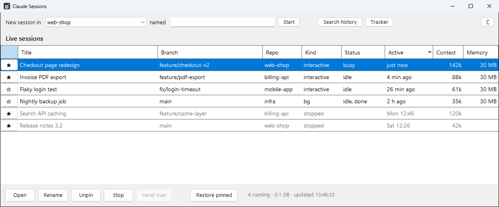
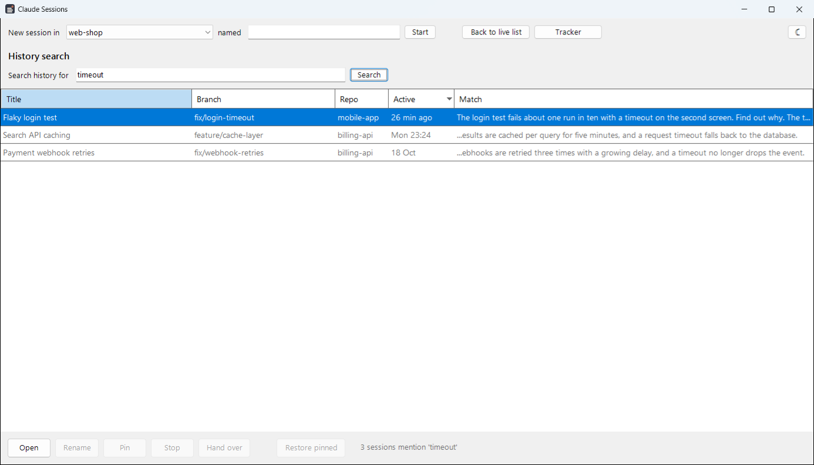
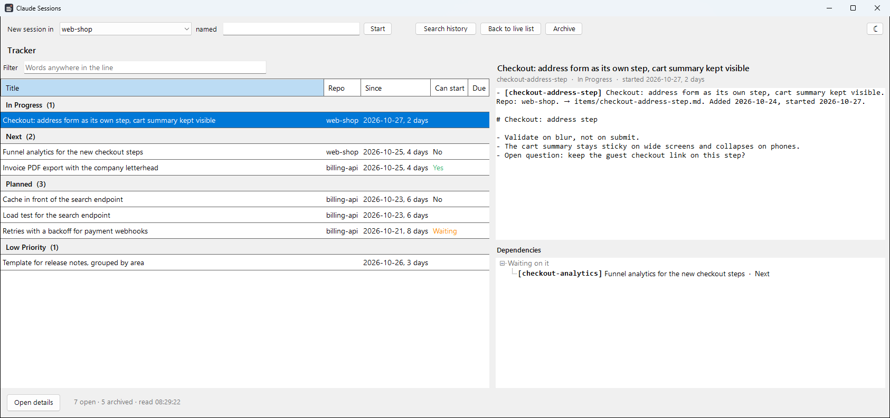

# claude-sessions-dashboard

A small Windows window and a set of `cc*` PowerShell commands for keeping track of many Claude Code sessions at once.



- **See what is running**: every session with its title, git branch, repo, status, last activity, context size and memory.
- **Start, open and stop** sessions, each in its own Windows Terminal tab.
- **Rename and pin** sessions, and bring all pinned ones back after a reboot with one click.
- **Search history**: find a past session by anything you or Claude said in it, and resume it.
- **Hand over**: when a session's context is full, have it write a handover document and continue in a fresh session that
  starts from it.
- **Optional task tracker**: if you keep a to-do list for your sessions in `~/.claude/tracker`, see it by section with its
  dependencies drawn as a tree. See [Optional: task tracker](#optional-task-tracker).

## Requirements

- Windows with PowerShell 7.4 or later (`pwsh`) and Windows Terminal
- Claude Code on `PATH`, recent enough for `claude agents --json`

## Install

Clone the repo (or download and unzip it), then run the installer from PowerShell 7:

```powershell
git clone https://github.com/dcrnojevac/claude-sessions-dashboard.git
cd claude-sessions-dashboard
./Install.ps1 -ReposRoot C:\src -DefaultRepo my-repo
```

`-ReposRoot` is the folder that holds your repos, directly or in folders of their own, and `-DefaultRepo` the repo that commands
use when you name none, as its path from there (`my-repo`, or `Clients\my-repo`). Leave them out and the installer asks. If you downloaded a zip, unblock the files first:
`Get-ChildItem -Recurse | Unblock-File`.

The installer, all for your user only and without admin rights:

1. copies the `ClaudeSessions` module into your PowerShell 7 modules folder (usually `Documents\PowerShell\Modules`),
2. adds `Import-Module ClaudeSessions` to your pwsh profile, after asking,
3. creates `%LOCALAPPDATA%\ClaudeSessions\settings.json` from `-ReposRoot` and `-DefaultRepo`, if there is none yet,
4. creates a **Claude Sessions** Start menu shortcut for the window. Pin it to the taskbar and the open window shows under the
   pin.

Then open a new pwsh tab and run `cchelp`, or open **Claude Sessions** from the Start menu. Make PowerShell 7 your default Windows
Terminal profile (Settings > Startup > Default profile): Windows PowerShell 5.1 reads a different profile, so the commands do not
exist there.

**Update** by pulling the repo and running `./Install.ps1` again. It replaces the module files and leaves your settings, pins and
labels alone. Files in the installed folder that the new version no longer ships are kept and listed.

| Option | Effect |
| --- | --- |
| `-WhatIf` | Shows what would change, and changes nothing |
| `-Force` | Skips the questions |
| `-Link` | Links the installed module folder to this repo instead of copying it, so edits take effect in the next new tab; for working on the tool itself |
| `-Uninstall` | Removes the shortcut, the profile line and the module folder (to the Recycle Bin); a linked install is removed as a link, so the repo is untouched |
| `-RemoveData` | With `-Uninstall`, also removes your pins, labels, handovers and search cache |

With `-Link`, the installed tool is the repo's working tree: a branch you check out is what runs, and moving the repo breaks the
install until you run the installer again.

## The window

The window lists running sessions first, most recently active on top, then pinned sessions that are not running (greyed). It
refreshes every 10 seconds while it is not minimized. Header clicks sort; hover a title for the session's last prompt and ID. It
is light or dark as the Windows app mode is (Settings > Personalization > Colors) until you switch it with its own button; dark
needs PowerShell 7.5 or later, and on 7.4 the window is always light and has no switch.

| Action | How |
| --- | --- |
| Open | **Open**, double-click or Enter: attaches to a background session, or resumes a stopped one in a new tab |
| Start | Pick a repo, optionally type a name, then **Start** or Enter |
| Rename | **Rename** or F2. An empty name goes back to Claude's own title |
| Pin or unpin | The star, or **Pin** / **Unpin** |
| Stop | **Stop**, after asking. The conversation is kept, so a stopped session can be resumed |
| Hand over | **Hand over**, after asking. See below |
| Restore pinned | Opens every pinned session that is not running, each in its own tab |
| Search history | **Search history** or Ctrl+F; Esc goes back |
| Tracker | **Tracker**, there only when you have one; Esc goes back. See [Optional: task tracker](#optional-task-tracker) |
| Light or dark | The sun or moon at the top right: the window closes and opens again in the other mode, which it keeps from then on |

The right-click menu has the same actions. One action runs at a time, and the buttons are disabled while it does, so extra
clicks cannot start a session twice. Launching the window while it is open brings the open one to the front. **Memory** is each
session's private memory, the part that counts against the Windows commit limit.

## Commands

Open a new pwsh tab and run `cchelp` for this list. Commands that take `<title|#>` accept part of a title, or a number from the
last `ccl` or `cch` in that tab. Tab completion fills in repos and titles.

Repos can sit directly in `reposRoot` or in folders inside it, down to three levels (`Clients\Acme\web-shop`); a folder with a
`.git` is a repo. Commands take a repo's name, or its path from `reposRoot` when two repos share a name, and the window's repo list
shows paths, so repos group by folder. A top folder with no repo in it is listed as it is, so a root of plain project folders
works as before.

| Command | Does |
| --- | --- |
| `acd [repo]` | Go to a repo under `reposRoot`, by name or by path (`defaultRepo` when omitted) |
| `cc [repo] [claude flags]` | Start Claude in a repo, here in this tab, e.g. `cc my-repo -n "feature x"` |
| `ccbg [repo] [claude flags]` | Start Claude in the background |
| `ccr [repo] [search]` | Pick a past session in a repo to resume |
| `cca` | Open Claude Code's agent view (background sessions) |
| `ccl` | List sessions by last activity, numbered |
| `cch <words>` | Search all session history; `"quotes"` for a phrase |
| `cco <title\|#>` | Open a background session in this tab, or resume a stopped one here |
| `ccstop <title\|#> [-Force]` | Stop a session after asking (`-Force` when it is busy) |
| `cchandover <title\|#>` | Hand a session over to a fresh one, after asking |
| `ccpin`, `ccunpin <title\|#>` | Pin or unpin a session |
| `ccrename <title\|#> [label]` | Label a session; no label goes back to Claude's title |
| `ccrestore` | Open every pinned session that is not running, each in its own tab |
| `ccui` | Open the window |

## Search history

**Search history** in the window, and `cch <words>` in a terminal, find past sessions by what was said in them: your prompts,
Claude's replies and the titles, not tool output or the context Claude Code adds by itself. Every word and `"quoted phrase"` must
appear, matched from the start of a word: `part` finds partition and `notifier` finds EtlRunNotifier, but `rent` does not find
current. Open a result to resume it; the window then goes back to the live list. Open is the only action on results.



Claude Code deletes transcripts after `cleanupPeriodDays` (30 by default, in `~/.claude/settings.json`), so search only reaches
back that far; raise it to keep more. The first search reads every transcript and takes a while; later ones only re-read the
sessions that changed.

## Hand over

When a session's context is filling up, **Hand over** (or `cchandover`) continues it in a fresh one. The session must be idle.
After asking, the tool:

1. stops the session,
2. has it write a handover document in one more turn (goal, decisions, current state, open questions, next steps) and saves it
   to `%LOCALAPPDATA%\ClaudeSessions\handovers\`,
3. starts `<title> (2)` in a new tab with a prompt to read the handover and wait for your instructions,
4. pins the new session in place of the old one.

That extra turn re-reads the whole conversation, so on a large session it is one expensive turn. If anything fails, nothing
else happens: the old session stays pinned and can be resumed.

## Optional: task tracker

A to-do list across all your work, kept as plain Markdown files that every Claude session reads at its start and updates as it
goes. It is optional and separate from the install: the installer never creates it, and without it the window has no
**Tracker** button and works as before.



**Tracker** in the window shows:

- the items by section, each with its repo, since when it has been in its state and for how long (hover for the stamp itself),
  whether it can start (green once everything in its `After:` is archived, orange while it waits on an outside event, red for an
  unknown id; hover for what it waits on), and its due date, orange within 3 days and red on the day or past it;
- **Filter** above the list: only the lines that hold every word typed, in the open items and the archive alike. Ctrl+F goes to
  it, and Esc clears it;
- the selected item's title, its line and its details file. **Open details**, double-click or Enter opens the file in your
  Markdown editor;
- **Dependencies** of the selected item, from its `After:` links: what it waits on and what those wait on, then what waits on it.
  Green is done (archived, so what waits on it can start), orange an outside event, red an id that is neither in the tracker nor
  in the archive. Double-click an item there to go to it;
- **Archive** at the top: `archive.md` grouped by repo, newest first; click a column header to sort by it instead. **Back to
  tracker** or Esc leaves it.

It never writes the files, and rereads them within 2 seconds of a change. A line it cannot read is shown as written, greyed,
under its section, so a bad edit never hides the rest.

### Set it up

1. Create the folder and the index:

   ```powershell
   New-Item -ItemType Directory -Force ~/.claude/tracker/items
   Set-Content ~/.claude/tracker/TRACKER.md "# Tracker`n`n## In Progress`n`n## Next`n`n## Planned`n`n## Low Priority"
   Set-Content ~/.claude/tracker/archive.md "# Tracker archive`n`nFinished items, one line each."
   ```

2. Add the instructions below to your global `~/.claude/CLAUDE.md`, so every session keeps the tracker.
3. Bring the window to the front, or open it: the **Tracker** button appears.

To keep the tracker somewhere else, set `trackerPath` in `settings.json` (see [Settings and data](#settings-and-data)) to the
folder's full path, and use that path in the instructions too.

### Files

| Path | Holds |
| --- | --- |
| `TRACKER.md` | The index and the only file sessions read at start: `## In Progress`, `## Next`, `## Planned` and `## Low Priority`, in that order, one item per line |
| `items/<id>.md` | Optional details for one item, deleted when the item is archived |
| `archive.md` | Finished items, one line each, append-only |

Each item is one Markdown bullet:

```text
- [<id>] <title and short description>. Repo: <repo>. After: [<other-id>]. Trigger: <when to pick it up>. Due: <YYYY-MM-DD>. → items/<id>.md. Added <YYYY-MM-DD>, started <YYYY-MM-DD>.
```

- `[<id>]` is kebab-case and always comes first.
- `Repo:` names the repo the work is in, by its folder name. Work outside any repo leaves it out.
- `After:` is a hard blocker: the item cannot start before it finishes. It names an id, several (`After: [a], [b]`), an outside
  event (`After: the vendor ships 5.0`), and can repeat.
- `Trigger:` says when to pick the item up. A Planned item has `After:`, `Trigger:` or both.
- `Due:` is a real date the item must be done by, as `YYYY-MM-DD`.
- `→ items/<id>.md` links the details file. `Repo:`, `After:`, `Trigger:`, `Due:` and the link are each optional.
- The line ends with its history, one dated stamp per event, oldest first: `Added`, then `started`, `planned`, `moved to Low Priority`,
  and so on. A move between sections adds a stamp and never rewrites an earlier one.
- In `archive.md` the line keeps its stamps, adds `archived <YYYY-MM-DD>`, and ends with a few words on the outcome.
- Low Priority holds things worth doing, but not now.

For example:

```markdown
## In Progress

- [usage-metrics] Usage metrics per API key. Repo: public-api. → items/usage-metrics.md. Added 2026-01-05, started 2026-01-08.

## Next

- [rate-limits] Rate limits on the public API. Repo: public-api. After: [usage-metrics]. Added 2026-01-05.

## Planned

- [driver-upgrade] Database driver upgrade. Repo: billing. After: the vendor ships 5.0. Trigger: next maintenance window. Added 2026-01-05, planned 2026-01-09.
```

and in `archive.md`:

```markdown
- [api-docs] API reference docs. Repo: public-api. Added 2026-01-02, started 2026-01-03, archived 2026-01-06. Published; the auth section still needs examples.
```

### Instructions for Claude

Copy this into `~/.claude/CLAUDE.md`:

```markdown
## Tracker

- **`~/.claude/tracker/TRACKER.md` is my to-do list across all my work, in and outside repos**: read it at the start of a session. When something is started, planned or finished during a session, update it in the same turn. Each item is one line in In Progress, Next, Planned or Low Priority, starting with a kebab-case `[id]`; `Repo: <name>` names the repo the work is in, by its folder name, and is left out for work outside a repo. Its details, if it needs any, go in `items/<id>.md` beside it, linked from the line as `→ items/<id>.md`, never in the index. `After: [id]` or `After: <event>` names what must finish before the item can start, and only that; `Trigger:` says when to pick it up. A Planned item always has one or the other. `Due: <date>` is set only for a real date (a client meeting, a cutover window, an expiring credential), never an invented one; when I ask what's next, an item due soon comes first, from any section. When archiving an item, tell me which items it unblocked, without moving them. Every line ends with its dated history, one stamp per event, oldest first (`Added 2026-01-05, started 2026-01-08, planned 2026-01-09.`); a move between sections adds a stamp and never rewrites an earlier one. A finished item moves to `archive.md` as one line keeping its stamps plus `archived <date>` and a few words on the outcome, and its details file is deleted. Low Priority holds things worth doing but not now: leave them out when I ask what's next unless nothing else is left.
```

## Settings and data

Everything the tool keeps is in `%LOCALAPPDATA%\ClaudeSessions\`:

| File | Holds |
| --- | --- |
| `settings.json` | `reposRoot`, the folder that holds your repos, and `defaultRepo`, the repo to use when none is named, by name or by its path from `reposRoot`; `colorMode`, `Light` or `Dark`, once you switch it in the window (remove it to follow Windows again); optionally `trackerPath`, the [task tracker](#optional-task-tracker)'s folder when it is not `~\.claude\tracker` |
| `pins.json`, `labels.json` | Your pinned sessions and session names |
| `handovers\` | Handover documents |
| `history\` | The search cache: the text of each session. Deleting it only makes the next search rebuild it |

## What it touches

- **Runs** `claude agents --json` to list sessions, and `claude`, `claude --resume` or `claude attach` in a new Windows Terminal
  tab when you click or type the matching action. Stop ends the session's process, or runs `claude stop` for a background
  session. Hand over also runs `claude -p --resume` in the session's folder, which adds the handover turn to the old
  conversation.
- **Reads** the end of each session's transcript under `~\.claude\projects\` (the last 256 KB, up to 4 MB when the title is
  further back) for its title, branch, last prompt and context size, and for search the whole transcript, once per change. It
  never writes there. If you have a [task tracker](#optional-task-tracker), it reads its files too, and never writes them.
- **Writes** only its own files in `%LOCALAPPDATA%\ClaudeSessions\`, each through a temporary file that replaces the old one, so
  nothing reads a half-written file. The only file it ever removes is a search-cache entry whose transcript Claude Code has
  already deleted, and that goes to the Recycle Bin.

## When Claude Code changes

The tool reads Claude Code's own session list (`claude agents --json`) and its internal transcript format, and both can change
with any update. It is built to stop rather than guess:

- If `claude agents --json` prints anything but a list, or an entry lacks a field the tool acts on, every command and the window
  report the change and do nothing.
- Every `claude` call the tool waits on has a time limit (20 seconds for listing and stopping, 15 minutes for a handover turn)
  and is killed past it. Closing the window also ends any `claude` it started that is still running.
- Open, Restore, `cco` and Hand over check again right before resuming, and refuse a session that Claude lists as running, that
  any `claude` process names on its command line (a tab still starting, or a handover being written, in any shell), or that was
  opened here in the last 15 seconds.
- Stop only ends a session whose status is `idle` (or `busy`, after asking or with `-Force`), and only when the process is a
  `claude` started when Claude says the session started.
- Hand over changes the pins only after the handover came back from the resumed session itself and the new session is running
  under the ID it was given.
- The search cache is left alone if no transcripts are found at all.

Titles, branches and context sizes are only displayed, so a transcript format change makes them fall back to plain session names
rather than stopping the tool.

## Development

| Path | Holds |
| --- | --- |
| `ClaudeSessions/` | The module as installed: `ClaudeSessions.psm1` loads `Storage.ps1` (pins, labels, settings), `Sessions.ps1` (the session list, starting, resuming and stopping), `History.ps1`, `Handover.ps1`, `Tracker.ps1` (reading the optional task tracker) and `Commands.ps1` (the `cc*` commands); `ClaudeSessionsWindow.ps1` is the window |
| `Tests/` | Pester tests |
| `Docs/` | The screenshots and the scripts that make them and the icon |
| `Install.ps1` | The installer |

Install with `./Install.ps1 -Link` to run your working copy. The tests use Pester 5 or later
(`Install-Module Pester -Scope CurrentUser -SkipPublisherCheck`; Windows ships the older 3.4). From the repo root:

```powershell
Invoke-Pester ./Tests
```

They never touch your sessions, pins, labels or install: Claude Code, processes and tabs are mocked, files go to Pester's
temporary drive, and the runner tests start `pwsh` in place of `claude`.

`Docs/New-Screenshot.ps1` retakes the screenshots by running the window against made-up sessions in a temporary folder (close
your own window first), and `Docs/New-Icon.ps1` redraws the icon.

## Uninstall

```powershell
./Install.ps1 -Uninstall
```

Add `-RemoveData` to also remove `%LOCALAPPDATA%\ClaudeSessions\`. Without the installer: delete the module folder and the
Start menu shortcut, and remove the `Import-Module ClaudeSessions` line from your profile.

## License

[MIT](LICENSE). This project is not affiliated with or endorsed by Anthropic; Claude and Claude Code are Anthropic's trademarks.
